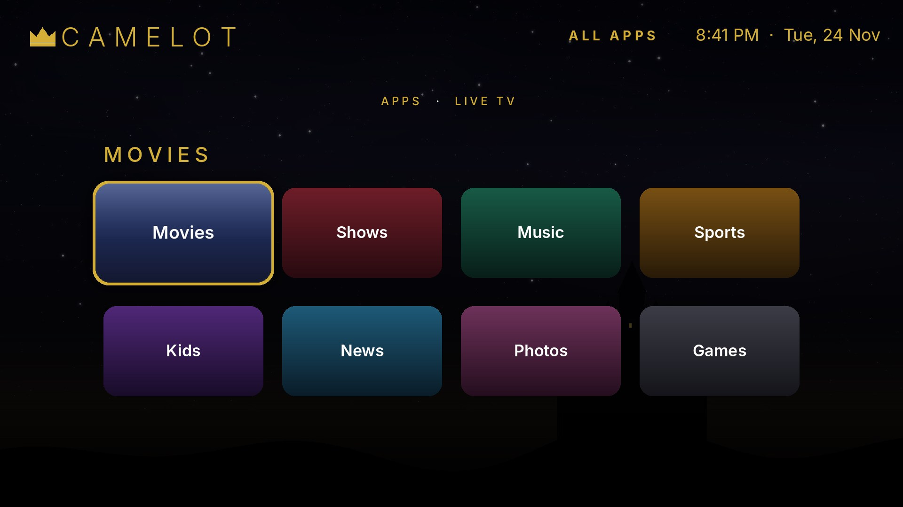

<div align="center">

# 👑 CAMELOT

**A clean, ad-free home screen for Android TV and Google TV.**
Your apps, your shows, your backgrounds. Nothing else.



<sub>Illustration of the layout. On a real TV, each tile shows that app's own banner.</sub>

</div>

---

## What you get

- **Only your apps.** Pick up to 8 (or more) apps for the home screen. Everything else waits in the **All Apps** panel.
- **No ads and no "recommended for you".** Camelot shows nothing you didn't choose.
- **Your shows in rows.** You see "continue watching" and the show rows that your apps share with the TV.
- **Live TV page.** One-click tiles for your set-top box, console or anything else on HDMI.
- **Your own backgrounds.** Drop pictures in a folder. They crossfade with a slow zoom.
- **Your colours.** Change the accent colour, the title, the number of columns, the speed and more in one settings file.
- **Made for the remote.** Smooth focus animations and predictable D-pad movement.
- **Nothing is deleted.** Any app you turn off is disabled, not uninstalled. One command brings back the original home screen.

It's made for any Android TV or Google TV running Android 6 or newer, whatever the brand: TCL, Sony, Philips, Hisense, Xiaomi, Chromecast with Google TV, Nvidia Shield and others. So far it has been tested on a TCL Google TV running Android 11, and reports from other TVs are welcome. **Fire TV** can run it as an app, but Fire OS won't let anything replace its home screen.

---

## Setup, step by step

You need a computer (Windows, Mac or Linux) on the **same Wi-Fi or network** as the TV. Setup takes about 20 minutes the first time.

### 1. Turn on debugging on the TV

1. On the TV, open **Settings → System → About**. On older Android TVs it's **Settings → Device Preferences → About**.
2. Scroll to **Android TV OS build** (or **Build**) and press **OK** 7 times, until it says you're a developer.
3. Go back to **Settings → System → Developer options** and turn on **USB debugging**. If you see **Network debugging** or **ADB over network**, turn that on too.
4. Find the TV's IP address under **Settings → Network & Internet → (your network)**. It looks like `192.168.0.25`.

> Some newer TVs only have **Wireless debugging**, which uses a pairing code. See [Pairing code TVs](docs/TROUBLESHOOTING.md#pairing-code-tvs).

### 2. Install the tools on your computer

| What | Where to get it |
|---|---|
| **Python 3.8+** | [python.org](https://www.python.org/downloads/). On Windows, tick **"Add python.exe to PATH"** during setup. |
| **Android Studio** (this gives you the Android SDK and Java) | [developer.android.com/studio](https://developer.android.com/studio). Open it once and finish the setup wizard. |
| SDK parts | In Android Studio open **More Actions → SDK Manager**. Under **SDK Platforms**, tick **Android 11 (API 30)** or newer. Under **SDK Tools**, tick **Build-Tools** and **Platform-Tools**. Click **Apply**. |
| *(optional)* Pillow | `pip install Pillow`. It resizes your background pictures automatically. |

If you'd rather not install Android Studio, the command-line SDK tools plus any **JDK 11 or newer** (for example [Temurin 17](https://adoptium.net)) work too.

### 3. Get Camelot

Click **Code → Download ZIP** on this page and unzip it, or use git:

```
git clone https://github.com/harish-gattikoppula/CAMELOT.git
cd CAMELOT
```

Run every command below **from inside the CAMELOT folder**. On Windows, if `python` doesn't work, use `py` instead.

### 4. Check everything is ready

```
python tools/camelot.py doctor
```

It tells you exactly what's missing, if anything.

### 5. Connect to the TV

```
python tools/camelot.py connect 192.168.0.25
```

Use your TV's IP address. The first time, **look at the TV**: tick **"Always allow from this computer"** and press **OK**. Run the command again if it timed out. The address is remembered after that.

### 6. Choose your apps

```
python tools/camelot.py apps
```

This lists the package name of every app on your TV. Open **`config/camelot.json`** in any text editor (Notepad, TextEdit, VS Code) and set:

- **`homeApps`**: the tiles on the home screen, in order.
- **`showRows`**: the apps whose shows appear in rows under the tiles.
- **`hiddenApps`**: apps to keep out of the All Apps panel.
- **`liveInputs`**: Live TV tiles, for example `{ "name": "Set-top box", "hdmiPort": 2 }`.

Every setting is explained in **[docs/CUSTOMIZE.md](docs/CUSTOMIZE.md)**.

### 7. Add backgrounds *(optional)*

Put your own pictures (`.jpg`, `.png` or `.webp`) in the **`backgrounds/`** folder. One original dark picture is already there. Delete it if you don't want it. Landscape pictures look best. See [backgrounds/README.md](backgrounds/README.md).

### 8. Build, install and make it your home screen

```
python tools/camelot.py setup
```

This builds the app, installs it, and asks before turning off the TV's stock home screen. **It is not deleted, and you can switch back any time.** Press **Home** on the remote and you're in Camelot. 👑

You can also run the three steps one at a time: `build`, then `install`, then `set-home`.

### 9. When you change something later

Edit `config/camelot.json` or the `backgrounds/` folder, then:

```
python tools/camelot.py build
python tools/camelot.py install
```

### 10. *(Optional)* Turn debugging off again

When you're happy, you can turn **USB debugging** off in Developer options. Camelot keeps working. Turn it back on whenever you want to change something.

---

## Let an AI assistant do it

The steps above are written for people, but an AI coding assistant can do all of them for you: Claude Code, Codex, Gemini CLI, Cursor and others. Open this folder in it and say:

> *Set up Camelot on my TV. Its IP is 192.168.0.25.*

**[PROMPT.md](PROMPT.md)** tells the assistant how to find your apps and HDMI inputs and to ask you before changing anything on the TV. The `CLAUDE.md`, `AGENTS.md` and `GEMINI.md` files point assistants to it.

---

## Turn off preinstalled extras *(optional)*

```
python tools/camelot.py debloat google    # Google extras (Play Games, screensaver, ...)
python tools/camelot.py debloat tcl       # TCL extras (tested on a TCL Google TV, Android 11)
python tools/camelot.py undo-debloat      # turn everything back on
```

Camelot shows you the list first and asks. Apps are **disabled, never uninstalled**. See [debloat/README.md](debloat/README.md) to make a list for your TV brand.

---

## Undo everything

```
python tools/camelot.py restore-home     # the original home screen comes back
python tools/camelot.py uninstall        # restores the home screen, then removes Camelot
python tools/camelot.py undo-debloat     # turns back on anything debloat turned off
```

A factory reset also undoes everything. Camelot never roots the TV or changes system files.

---

## Good to know

- **Show rows** come from what each app shares with the TV. Some apps share a lot, some share only "continue watching", and some share nothing. Netflix only shares continue watching. To add Netflix's public Top 10 to its row, set `netflixTop10Country` (see [CUSTOMIZE](docs/CUSTOMIZE.md#netflix-top-10)). That reads Netflix's public web page, so it may stop working if Netflix changes the page. When that happens, the row simply shows less.
- **Privacy.** Camelot has no accounts, analytics or ads. It goes online only to load show pictures, plus the optional Netflix Top 10 page.
- **Your signing key** is created on your computer in the `.camelot/` folder, which is never uploaded. Keep that folder. If you lose it, run `uninstall` once before installing a new build.
- **After a TV update**, the stock home screen sometimes turns itself back on. Run `python tools/camelot.py set-home` again.

Problems? See **[docs/TROUBLESHOOTING.md](docs/TROUBLESHOOTING.md)**.

---

## Project layout

```
config/camelot.json     your settings: apps, rows, inputs, colours, timing
backgrounds/            your background pictures
launcher/               the Android app (Java, no Gradle needed)
tools/camelot.py        the helper: build, install, set home, debloat, restore
debloat/                lists of preinstalled apps that can be turned off
docs/                   customizing and troubleshooting
PROMPT.md               instructions for AI assistants
```

## Contributing

Pull requests are welcome, especially:

- debloat lists for other TV brands (say which model and Android version you tested on),
- fixes for TVs that behave differently,
- new settings in `config/camelot.json`.

Please don't commit anything from `.camelot/`, `build/` or any `.apk`/`.jks` files. Keep personal details such as your TV's IP address out of issues and pull requests.

## Licence

[MIT](LICENSE) © 2026 Harish Gattikoppula

Camelot is an independent project. It is not affiliated with Google, Netflix, Amazon, Disney, Apple, TCL or any other company. App and brand names belong to their owners and are used only to identify apps.
